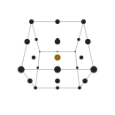

  <a href="https://nishan-charlie.github.io/portfolio/">
    <picture>
      <source media="(prefers-color-scheme: dark)" srcset="assets/banner-dark.svg">
      
    </picture>
  </a>

  &nbsp;
  &nbsp;
  &nbsp;
  &nbsp;
  &nbsp;
  &nbsp;
  

    

  <picture>
    <source media="(prefers-color-scheme: dark)" srcset="assets/hero-dark.svg">
    
  </picture>

    

  

    I am a computer vision researcher from Sri Lanka working on <b>explainable AI for Vision Transformers</b>,
    <b>medical image analysis</b> and <b>vision language models for 3D data</b> such as MRI and CT.
    Previously a Lecturer in Software Engineering at Sabaragamuwa University of Sri Lanka, I am now
    researching full time and <b>open to PhD opportunities</b> and research collaborations.
  

   

  <a href="https://github.com/Nishan-Charlie">
    <picture>
      <source media="(prefers-color-scheme: dark)" srcset="https://github-stats-extended.vercel.app/api?username=Nishan-Charlie&show_icons=true&hide_border=true&count_private=true&bg_color=0d1117&title_color=e6edf3&text_color=e6edf3&icon_color=e3b341">
      
    </picture>
  </a>
   

  <picture>
    <source media="(prefers-color-scheme: dark)" srcset="assets/toolkit-dark.svg">
    
  </picture>
  &nbsp;
  <picture>
    <source media="(prefers-color-scheme: dark)" srcset="https://streak-stats.demolab.com/?user=Nishan-Charlie&hide_border=true&background=0d1117&stroke=30363d&ring=e3b341&fire=e3b341&currStreakNum=e6edf3&sideNums=e6edf3&currStreakLabel=e3b341&sideLabels=7d8590&dates=7d8590">
    
  </picture>

    

  <a href="https://follow.lazybittu.workers.dev/user/Nishan-Charlie">
    <picture>
      <source media="(prefers-color-scheme: dark)" srcset="https://follow.lazybittu.workers.dev/user/Nishan-Charlie.svg?preset=banner&time=three_months&border=false&theme=dark">
      
    </picture>
  </a>
   
  Follower graph by <a href="https://github.com/Bittu5134/GH-Follow-Tracker">Bittu5134/GH-Follow-Tracker</a>

    

  <picture>
    <source media="(prefers-color-scheme: dark)" srcset="https://raw.githubusercontent.com/Nishan-Charlie/Nishan-Charlie/output/github-contribution-grid-snake-dark.svg">
    
  </picture>

    

  <picture>
    <source media="(prefers-color-scheme: dark)" srcset="assets/footer-3d-dark.svg">
    
  </picture>
   
  

  

<!-- Assets in ./assets are generated by scripts/build_assets.py -->
